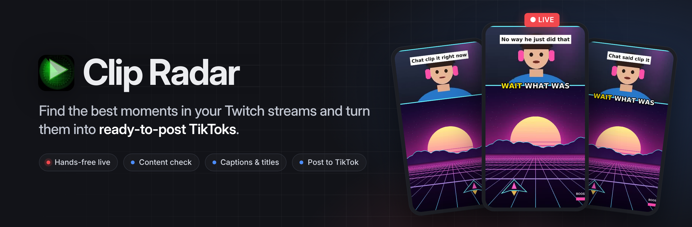
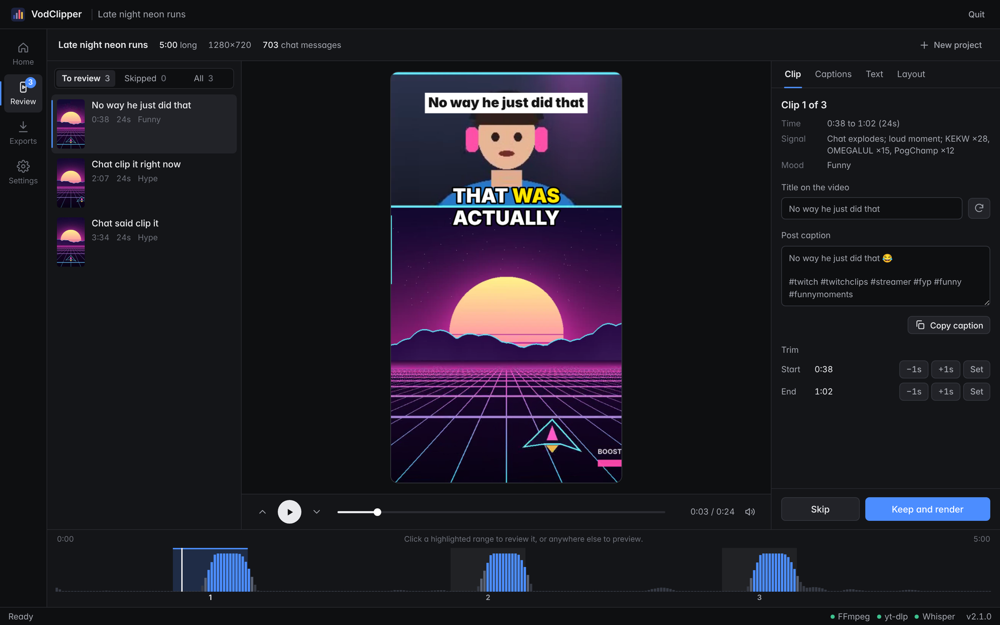
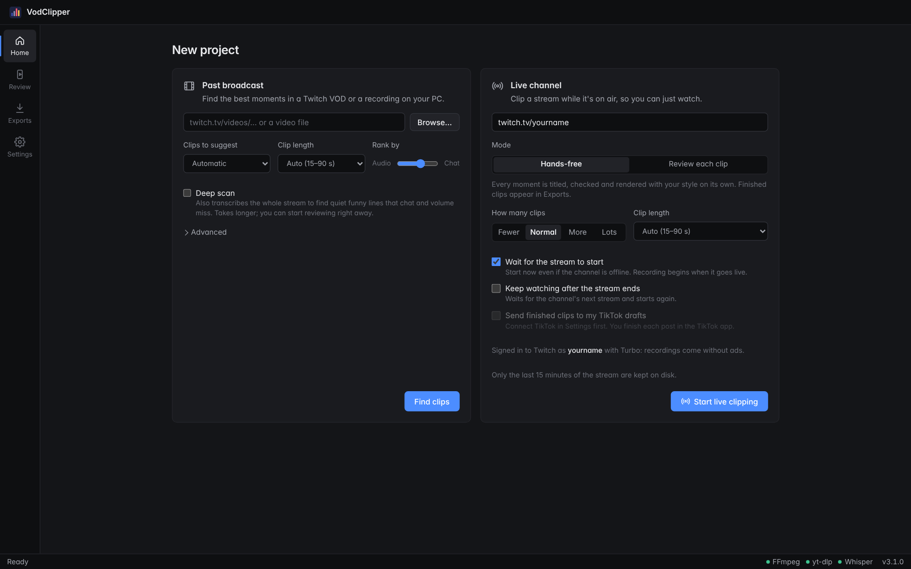
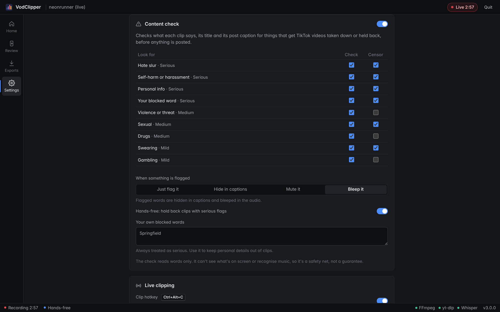
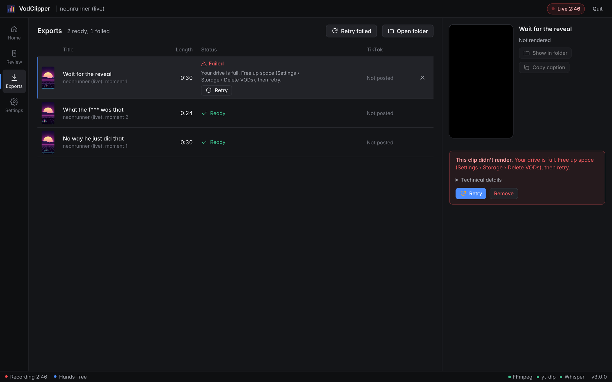

<p align="center">
  
</p>

<p align="center">
  <a href="https://github.com/allen1versonfr/ClipRadar_macOs/releases/latest"></a>
  <a href="https://github.com/allen1versonfr/ClipRadar_macOs/actions/workflows/build.yml"></a>
  
  
  
</p>

<p align="center">
  <a href="https://github.com/allen1versonfr/ClipRadar_macOs/releases/latest/download/ClipRadar-macOS-arm64.dmg"><b>Download for Apple silicon</b></a>
  &nbsp;·&nbsp;
  <a href="https://github.com/allen1versonfr/ClipRadar">Windows version</a>
  &nbsp;·&nbsp;
  <a href="CHANGELOG.md">Changelog</a>
</p>

---

**Clip Radar for macOS** is the Mac port of [Clip Radar](https://github.com/allen1versonfr/ClipRadar). It watches a Twitch stream the way your chat does. It finds the moments where chat explodes and the audio spikes, cuts them into vertical 9:16 clips with captions and a title, and lets you review and post them to TikTok. It works on a past broadcast, or live while you're still streaming. Everything runs on your own Mac.

This port is based on Clip Radar 4.36.0 (`allen1versonfr/ClipRadar@aca233d`) and has the same features, interface and clip pipeline. What's different on a Mac is listed under [What the port changes](#what-the-port-changes).

<p align="center">
  
</p>

## Features

- **Twitch, YouTube and X.** Open a Twitch VOD, a YouTube video, Short or finished livestream (with its chat replay), an X video, or a file on your Mac. Clip Twitch and YouTube livestreams as they happen, several at once, and follow everything under Home › Running now.
- **Finds the moments for you.** Clips are ranked by chat surges (KEKW, POG, "clip it", `?????`), audio spikes measured against the surrounding minutes, and laughter, screams and cheering heard by a small built-in sound detector. Twitch's muted DMCA sections are ignored.
  - Chat is counted by chatters, not messages: bots, `!commands`, giveaways, sub notices, gift bombs, raids and copypasta don't create fake moments.
  - It reads how chat reacts, not just how much it types: laughter in many languages ("hahaha", "jajaja", "kkkk", "ㅋㅋㅋ", "草") and stretched words ("LMAOOOO", "noooo"). Chat answering a question the streamer asked ("germany", "2 hours ago", "50") counts for less, and a moment where the streamer and chat react together counts for more.
  - The 7TV emotes chat uses most are read for what they mean (CAUGHT, AINTNOWAY, xdd, HUH, DIESOFCRINGE, o7...), even on YouTube or when the channel's emote lists don't load; emotes for vibing, greetings and sleep (catJAM, peepoHey, Bedge) never make a moment.
  - Awkward moments and confusing ones are clips too, and told apart: "uhhh", "ummm", 😬 and "yikes" make an *awkward moment*; "???", "huh" and "wdym" mean *chat confused*. Each gets a title and hashtags to match.
  - Ordinary YouTube videos have no chat, so they're ranked with YouTube's Most replayed graph and the timestamps people leave in the top comments ("3:45 when he fell"), next to the sound. YouTube's own captions title the clips straight away, and comments people agree on can title them too.
  - Each clip gets its own length (15 s to 2 minutes): it starts with the setup, runs until the reaction dies down, and never cuts mid-sentence.
  - Quality over quantity: on Automatic it suggests only the moments that stand out against the stream's own best ones, not a set number per hour.
  - **Deep scan** (optional) transcribes the whole stream and finds *quiet gems*: lines that landed even though chat and volume stayed calm.
  - It learns from the clips you keep, skip and post, separately for each streamer.
- **Hands-free live clipping.** Start it and go watch the stream. Every strong moment is titled, checked and rendered on its own, and finished clips land in Exports.
  - It can wait for the stream to start and keep watching for the next one.
  - Choose how many clips you want (Fewer, Normal, More or Lots).
  - Press <kbd>⌃ Control</kbd>+<kbd>⌥ Option</kbd>+<kbd>C</kbd> from any app to clip the last 30 seconds (while Clip Radar's window is open).
  - **No ads in your clips.** Ad breaks Twitch stitches into the stream are recognised and left out of the recording. Sign in to Twitch with Turbo (or a sub) and you get the ad-free stream.
- **Content check and censoring.** Each clip's words, title and post caption are checked for things TikTok takes down: slurs, self-harm, threats, personal info, sexual terms, drugs, swearing, gambling and your own blocked words.
  - Flagged words can be hidden in captions, muted or bleeped.
  - Hands-free holds risky clips back for you to look at first.
- **Review in TikTok format.** Each suggestion plays in a phone-sized preview with its layout, title and word-by-word captions. Keep it with <kbd>Enter</kbd>, skip it with <kbd>X</kbd>, and move between clips with <kbd>↑</kbd> <kbd>↓</kbd>.
- **Auto titles and captions.** Whisper transcribes each clip. The title is the best line said near the peak, what chat agreed on or was talking about ("Chat lost it over the haircut"), or one that fits the mood, and every clip of a stream gets its own. Each gets a post caption and hashtags: the streamer, the game being played, what chat talked about and the mood.
- **Edit like CapCut.** Drag the title and captions anywhere on the frame, fix any caption line by typing over it, and add your own captions.
  - Five caption styles: Pop, Highlight, Karaoke, Glow and Clean.
  - Four title styles.
  - Eight bundled fonts, including Montserrat, Anton, Bebas Neue and Bangers.
- **Layouts and framing:** facecam above gameplay, the whole frame (following the streamer's face), the facecam alone, or a blurred fit. Auto-frame finds a facecam or a person and picks the layout.
- **Background render queue.** Clips render to 1080×1920 MP4 with VideoToolbox, the Mac's hardware video engine: it decodes the video and encodes H.264 or H.265, falling back to the CPU for a clip when it has to. If a render fails, Clip Radar says why in plain words and gives you a Retry button.
- **Watermarks you can move and share.** Up to six layers of text (any bundled font, colour, outline or box) and logo images, in a corner or dragged anywhere on the clip preview, each with its own size, opacity, rotation and timing. Save sets of them, and share one as a single file (images inside) or import one from a file or a Discord link.
- **Clipping campaigns and Discords.** Keep each clipping organisation's rules together under **Settings › Campaigns**: text and hashtags every post must carry, minimum and maximum clip length, the campaign's own watermark, and its Discord submission channel (a webhook).
  - Clips you keep while a campaign is active follow its rules, and Exports warns about clips that are too short or too long for it.
  - Finished clips can go to the campaign's Discord channel as soon as they render, with the video attached, or later with the link to your post.
  - Campaigns are shared and imported as one file, so a server can hand its clippers the rules and watermark in one go. The webhook is only included when you choose.
- **Post on TikTok** through TikTok Studio: the caption is copied, the video selected in Finder, and the upload page opened for you to finish.
- **Hashtags in file names and posts**, set separately: real `#Tag` text in each exported file's name (the streamer's own tag, your tags per streamer, general tags), and default hashtags for post captions per streamer and per platform.
- **Updates itself.** When a new release is posted on GitHub, Clip Radar offers it in the app. One click downloads it, replaces the app and reopens it.
- **Tidy on disk.** Delete VODs and Delete all clips buttons are built in.

## Screenshots

<table>
  <tr>
    <td width="50%"><p align="center"><sub><b>Hands-free live:</b> clips render on their own while you watch</sub></p></td>
    <td width="50%"><p align="center"><sub><b>Home:</b> automatic clip count and length, Deep scan, ad-free live</sub></p></td>
  </tr>
  <tr>
    <td width="50%"><p align="center"><sub><b>Content check:</b> flag, hide, mute or bleep</sub></p></td>
    <td width="50%"><p align="center"><sub><b>Exports:</b> failures say why, with Retry</sub></p></td>
  </tr>
  <tr>
    <td width="50%"><p align="center"><sub><b>Text:</b> styles, fonts and drag-to-place text</sub></p></td>
    <td width="50%"><p align="center"><sub><b>Captions:</b> fix what was heard, line by line</sub></p></td>
  </tr>
</table>

## Install

1. Download the disk image: **[Apple silicon (M1 and later)](https://github.com/allen1versonfr/ClipRadar_macOs/releases/latest/download/ClipRadar-macOS-arm64.dmg)**. Clip Radar is for Apple silicon Macs only.
2. Open it and drag **Clip Radar** to **Applications**.
3. Open Clip Radar from Applications. FFmpeg, yt-dlp and TwitchDownloaderCLI come inside the app.

> [!NOTE]
> The app isn't notarized by Apple yet, so the first time you open it macOS says it can't check it for malicious software. Open **System Settings › Privacy & Security**, scroll down and press **Open Anyway** next to Clip Radar. (On macOS 14 and earlier, Control-click the app in Applications and choose **Open**.) You only do this once.

**Requirements:** macOS 11 Big Sur or later, on Apple silicon (M1 and later). Captions download a Whisper model (a few hundred MB) the first time you use them. TikTok upload automation needs Google Chrome, Microsoft Edge, Chromium or Brave.

**Where things are:** clips and projects in `~/Movies/Clip Radar`; settings, downloaded tools, caption models and logs in `~/Library/Application Support/ClipRadar`.

**Uninstall:** quit Clip Radar and drag it to the Trash. Delete `~/Library/Application Support/ClipRadar` too to remove its settings, tools and models; your clips in `~/Movies/Clip Radar` stay until you delete them.

## Usage

| | |
|---|---|
| **Past broadcast** | Paste a VOD link (`twitch.tv/videos/…`) or browse to a recording on your Mac, then press **Find clips**. |
| **Live channel** | Enter a channel name or `twitch.tv/name`, pick **Hands-free** (clips render on their own) or **Review each clip**, choose how many clips you want, and press **Start live clipping**. It can start before the stream does. |
| **Review** | Keep (<kbd>Enter</kbd>) or skip (<kbd>X</kbd>) each suggestion. Trim it and edit the title (<kbd>T</kbd> cycles through ideas). Undo and redo with <kbd>⌘Z</kbd> / <kbd>⌘⇧Z</kbd>. During a live session, <kbd>C</kbd> clips the last 30 seconds, or <kbd>⌃⌥C</kbd> from any app. |
| **Exports** | Kept clips render here, named after their titles, with the post caption saved next to them as `.txt`. Select one to watch it or post it. |

The full guide ships inside the app (`Clip Radar.app/Contents/Resources/README.txt`) and is in [docs/user-guide.txt](docs/user-guide.txt).

## Posting to TikTok

Clip Radar gets each clip ready and you post it in **TikTok Studio**, TikTok's own upload page. In Exports, select a clip, check the caption, and press **Open in TikTok Studio**. The caption (with your post hashtags) is copied, the video is selected in Finder to drag into the page, and TikTok Studio opens in your browser. **Upload to TikTok** can also put the video in for you, in its own Chrome, Edge, Chromium or Brave window (Safari can't be driven that way).

## What the port changes

| | Windows | macOS |
|---|---|---|
| App window | Edge WebView2 | WebKit (pywebview's Cocoa backend) |
| Download | `ClipRadar-Setup.exe` (Inno Setup) | `ClipRadar-macOS-<chip>.dmg`, one per chip |
| Updates | runs the new installer silently | downloads `ClipRadar-macOS-<chip>.zip` from this repo's releases; after Clip Radar quits, a small script swaps in the new `Clip Radar.app` and opens it (`src/updater.py`) |
| GPU rendering | NVENC, Quick Sync, AMF | VideoToolbox (`h264_videotoolbox`, `hevc_videotoolbox`), with x264/x265 as the fallback as before |
| Whisper on the GPU | optional NVIDIA CUDA download | not offered: CTranslate2 has no Metal backend, so Whisper runs on the CPU (Apple silicon runs it quickly) |
| Helper tools | gyan.dev FFmpeg, `yt-dlp.exe`, TwitchDownloader Windows build | Martin Riedl's signed FFmpeg builds (evermeet.cx as a fallback), `yt-dlp_macos`, TwitchDownloader's MacOS / MacOSArm64 build; Homebrew's `/opt/homebrew/bin` and `/usr/local/bin` are searched too, since apps opened from Finder don't get your shell's `PATH` |
| Saved sign-ins (Twitch, GitHub token) | DPAPI | encrypted with a random key kept in your login Keychain (service "Clip Radar"); falls back to the old base64 format only if the Keychain can't be used (`src/secret.py`) |
| Clip hotkey | <kbd>Ctrl</kbd>+<kbd>Alt</kbd>+<kbd>C</kbd> (RegisterHotKey) | <kbd>⌃</kbd>+<kbd>⌥</kbd>+<kbd>C</kbd> (Carbon `RegisterEventHotKey`, no Accessibility permission needed). Works while the app window is open; not in `--browser` mode |
| Tools end with the app | job object | a small `/bin/sh` watcher outside the app's process group stops every adopted tool (and its process group) when Clip Radar ends, even after a Force Quit (`src/procjob.py`) |
| "File in use by…" | Restart Manager | `lsof` (`src/filelocks.py`) |
| Free memory | GlobalMemoryStatusEx | `sysctl hw.memsize` and `vm_stat` |
| Sounds | Windows message beeps | `afplay` with the system sounds |
| File dialogs | WebView2's, then Tk | the window's own (Cocoa), then Finder's through AppleScript in browser mode (Tk can't open windows off the main thread on a Mac) |
| Keep the computer responsive | below-normal priority class | `nice -n 10` |
| Folders | `%LOCALAPPDATA%\ClipRadar`, `Videos\Clip Radar` | `~/Library/Application Support/ClipRadar`, `~/Movies/Clip Radar` |

Everything else (finding moments, chat cleaning, the laughter detector, Whisper captions, titles, the content check, layouts, watermarks, campaigns, both interfaces) is the same code as the Windows version.

## Building from source

You need macOS 11+, Python 3.10–3.13 and, for the interface, Node.js 22. `install.sh` offers to install Python 3.12 with Homebrew if it's missing.

```bash
git clone https://github.com/allen1versonfr/ClipRadar_macOs
cd ClipRadar_macOs
scripts/install.sh       # virtualenv, packages, laughter detector, FFmpeg / yt-dlp / TwitchDownloaderCLI in tools/
scripts/run.sh           # run from source in its own window (add --browser for your browser)
scripts/build_app.sh     # build dist/Clip Radar.app, plus the .dmg and .zip a release carries
```

`build_app.sh` builds for the Mac it runs on. It signs the app ad hoc; set `CODESIGN_IDENTITY` to a "Developer ID Application" identity to sign it properly, and `NOTARY_PROFILE` (from `xcrun notarytool store-credentials`) to notarize and staple the DMG.

### Tests and releases

Every push runs `.github/workflows/build.yml` on GitHub's macOS runners:

- lint and the unit tests (the same suites as the Windows version, plus the Mac paths: the process watcher in `tests/test_child_cleanup.py`, `lsof` in `tests/test_filelocks.py`, the Mac update asset in `tests/test_versions.py`);
- the React UI's tests;
- builds the app on Apple silicon (`macos-15`), then runs the app's built-in self-test inside the build (`--selftest`: rendering, the encoder it picked, Whisper captions on speech made with `say`, auto titles, styled text placement, bleeping) and checks that the app starts and answers.

When `src/version.py` names a version with no release yet, a push to `main` publishes `vX.Y.Z` with both DMGs and zips and that version's notes from [CHANGELOG.md](CHANGELOG.md). Code signing and notarization switch on when these repository secrets exist: `MACOS_CERT_P12_BASE64` and `MACOS_CERT_PASSWORD` (a Developer ID Application certificate), and optionally `MACOS_NOTARY_APPLE_ID`, `MACOS_NOTARY_PASSWORD` (an app-specific password) and `MACOS_NOTARY_TEAM_ID`.

Run the tests locally:

```bash
python3 tests/test_safety.py
python3 tests/test_signals.py
python3 tests/test_child_cleanup.py
```

The Windows version's history is in [docs/CHANGELOG-windows.md](docs/CHANGELOG-windows.md).

---

<sub>Clip Radar isn't affiliated with Twitch, TikTok or Apple. Only clip streams you own or have permission to repost.</sub>
